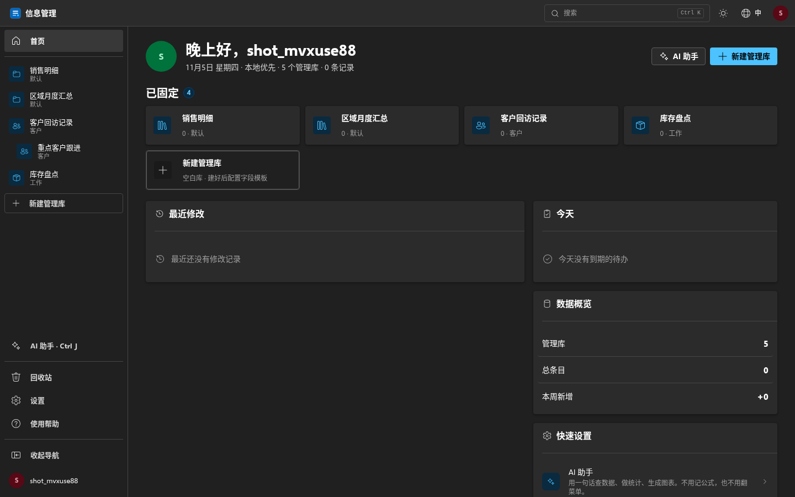

# AI 智能信息管理助手

**不用学 Excel，说一句话就能管数据。** 客户、库存、房源、账本——AI 帮你建库、录入、查数、画图。数据默认存在你自己的设备里，永久免费。

<p align="center">
  <a href="https://aiim.de5.net"></a>
  <a href="https://aiim.de5.net/intro"></a>
</p>

<p align="center">
  <a href="https://aiim.de5.net"></a>
</p>

> **打开网址 → 点「注册」→ 立刻开始用。** 网页版无需安装，手机电脑都能用；支持 Excel 一键导入；不需要手机号、不付费、不过期。

| 场景 | 能管什么 |
| --- | --- |
| 客户管理 | 名单、跟进状态、成交金额、下次联系时间 |
| 库存 / 商品 | 型号、数量、进价售价、库存预警 |
| 房源 / 项目 | 房源信息、带看记录、报价进度 |
| 账本 / 收支 | 每笔收支、分类、经手人、月度统计 |
| 任何表格 | 自定义字段 + 自然语言查询 / 统计 / 图表 |

一个基于 React + AI 的现代化信息管理 Web 应用，支持自定义管理库、字段配置、数据增删改查，以及深度 AI 对话集成——用自然语言就能操作数据。

## ✨ 功能特性

### 📚 管理库系统
- 无限创建管理库，支持分类管理
- 拖拽调整库的顺序
- 每个库独立配置字段模板，完全自定义

### 🏗️ 字段模板
- 7 种字段类型：文本、多行文本、数字、日期、下拉单选、复选框、评分
- 拖拽排序字段顺序
- 支持设置必填/可见属性
- 支持复用其他库的字段模板（不需要平台内置行业模板，全部由你自己定义）
- AI 可自动新增/修改/删除字段

### 📝 数据管理
- 条目增删改查，支持批量导入导出（CSV / Excel）
- 关键词搜索、字段筛选、升降序切换
- 置顶功能，重要信息优先展示
- 回收站机制，误删可恢复

### 🤖 AI 深度集成
- **自然语言操作**：一句话让 AI 帮你新增、修改、删除条目
- **数据查询与统计**：问 AI "统计每个分类有多少条" 或 "找出最近一周新增的记录"
- **工具调用确认**：所有写入操作弹出确认框，确保安全
- **永久记忆**：AI 会记住你的偏好和习惯，越用越懂你
- **自定义提示词**：可自定义 AI 系统提示词
- **思考过程折叠**：AI 的推理过程默认折叠，点击展开查看
- **操作撤回**：AI 执行的操作支持一键撤回
- **管理库/字段操作**：AI 可帮你创建库、重命名、添加字段等

### 🔐 账号与数据
- **自助注册**，注册成功即登录，无需二次登录
- 密码 PBKDF2-SHA256 加盐哈希（服务端不存明文）
- 记住登录状态（关闭浏览器再打开也不用重登）
- 本地存储优先（IndexedDB / Dexie.js），数据在你自己手里
- 可选 Supabase 云端同步，或局域网 WebRTC 面对面传输
- 账户永不过期；管理员可随时停用违规账户

### 🛠️ 管理后台（`/admin`）
- 运营概览：账户总数 / 今日注册 / 7 天活跃 / 7 天注册 / 已停用
- 账户管理：搜索、筛选（7 天内用过 / 30 天未用 / 已停用）、停用、恢复、删除
- **重置密码**：用户自助注册后自己持有密码，遗忘时由管理员生成临时密码（仅显示一次）
- CSV 导出、操作审计日志、用户行为分布
- 可用 `REGISTRATION_OPEN=0` 紧急关闭注册（被灌水时）

### 🎨 界面体验（v10 · Windows 11 风格 Fluent UI 应用）
- **基于 microsoft/fluentui（Fluent UI React v9）的 Windows 11 风格 Web 应用**：48px Fluent app bar + 232px 展开式导航（可收起为 68px 图标栏）+ Fluent 内容画布；**不是操作系统模拟**——没有壁纸、任务栏、浮动窗口、窗口按钮、锁屏时钟
- 页面：Fluent Card 首页 / 文件资源管理器式库页（Toolbar + 面包屑 + 数据表 + 页面内状态栏）/ Fluent 设置页 / Fluent 应用登录页 / 应用介绍落地页 / 获取帮助 / 管理后台 / AI 侧栏 / Fluent Dialog（编辑器、图表、确认、全局搜索 Ctrl+K）
- 设计系统：Fluent 2 design tokens（颜色/字体/圆角/阴影全部来自 Fluent theme `src/theme/win11.ts`）、Segoe UI Variable（Selawik 回退）、Fluent Button/Input/Dialog/Card/Switch/Accordion…；无渐变、无霓虹、无自定义 blur、无网页 Dashboard
- 深色（默认）/ 浅色双主题；桌面、平板、手机（底部标签栏）全部适配；`prefers-reduced-motion` 可访问性支持
- 设计说明：`DESIGN.md`；实现合同：`redesign-brief/12-v10-fluent-app.md`；设计系统：`design-system/win11-native/MASTER.md`

## 🛠️ 技术栈

| 类别 | 技术 |
|------|------|
| 框架 | React 18 + TypeScript |
| 构建 | Vite 5 |
| UI | Fluent UI React v9（主设计系统）+ Ant Design v5（DatePicker/Form 等复杂输入件，token 同源） |
| 状态管理 | Zustand |
| 路由 | React Router v6 |
| 本地存储 | Dexie.js (IndexedDB) |
| 云端存储 | Supabase |
| 拖拽 | @dnd-kit |
| 文件处理 | PapaParse + SheetJS (xlsx) |
| AI | OpenAI 兼容 API（Function Calling + 流式输出） |

## 🚀 快速开始

### 安装依赖
```bash
npm install
```

### 开发模式
```bash
npm run dev
```
访问 `http://localhost:5173`

### 生产构建
```bash
npm run build
```
构建产物输出到 `dist/` 目录

### 本地预览构建结果
```bash
npm run preview
```

## 📦 部署

### Cloudflare Pages
1. 将代码推送到 GitHub 仓库
2. Cloudflare Pages → Connect to Git → 选择该仓库
3. 构建配置：
   - Framework preset: `Vite`
   - Build command: `npm run build`
   - Build output directory: `dist`
4. 点击 Deploy，等待完成即可

> 项目已内置 `public/_routes.json`，静态资源跳过 Functions 层，SPA 路由刷新不会 404。

### 其他平台
- Vercel / Netlify：框架选 Vite 即可自动识别
- 任意静态托管：上传 `dist/` 目录，注意配置 SPA 回退到 `index.html`

## 📁 项目结构

```
src/
├── ai/                  # AI 相关
│   ├── client.ts        # OpenAI 兼容流式客户端
│   ├── tools.ts         # Function calling 工具定义
│   ├── contextBuilder.ts # 上下文构建
│   └── types.ts
├── components/
│   ├── ai/              # AI 对话面板、确认弹窗
│   ├── auth/            # 登录/注册页
│   ├── layout/          # 主布局、侧边栏
│   ├── library/         # 管理库视图、表格、编辑器、回收站
│   ├── fields/          # 字段渲染器
│   └── settings/        # 设置页
├── db/                  # 数据层（本地 / 云端 provider）
├── store/               # Zustand 状态管理
├── types/               # TypeScript 类型定义
├── utils/               # 工具函数（加密、导入导出等）
├── styles/              # 全局样式
├── App.tsx
├── main.tsx
└── router.tsx           # 路由配置
```

## ⚙️ AI 配置

登录后在「设置 → AI 配置」中填写（或由平台代管，见 DEPLOY.md）：

- **API 服务商地址**：如 `https://api.openai.com/v1` 或其他兼容地址
- **API Key**：你的 API 密钥
- **模型名**：如 `gpt-4o-mini`、`deepseek-chat` 等
- **预设提示词**（可选）：留空使用内置默认提示词
- **AI 记忆**（自动）：AI 会把你告诉它的重要信息保存到这里

## 📄 License

MIT


## 📣 分享 / 宣传素材

- 在线体验：<https://aiim.de5.net>
- 产品介绍长页：<https://aiim.de5.net/intro>
- 方版海报（扫码直达）：`docs/poster.png`
- 产品截图：`docs/screenshot.png`

如果这个工具帮你省了时间，欢迎把上面任意链接分享给需要管客户、库存、房源或账本的朋友。
